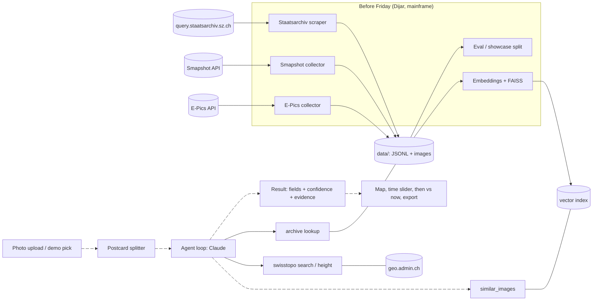

# ARCHITECTURE

Read with `CONTRACTS.md` (data shapes, APIs) and `RESEARCH.md` (sources, verified facts).

## 1. Overview

An agent locates and dates historical photos from the Staatsarchiv Schwyz. It forms hypotheses from visual cues, checks them with tools (similar reference images, archive lookups, swisstopo place names and terrain), rejects wrong candidates and returns per-field values with confidence and evidence. A web app shows the result on a map, a time slider over swisstopo historical maps, a then-vs-now view and an export in the archive's field structure.

## 2. Components and owners

| Component | Folder | Owner | Built |
|---|---|---|---|
| Scrapers (Staatsarchiv, Smapshot, E-Pics) | `data_pipeline/` | Dijar | before Fri |
| Gazetteer, eval/showcase/timeline splits | `data_pipeline/` | Dijar | before Fri |
| Embeddings + FAISS index | `data_pipeline/` | Dijar | before Fri |
| Postcard splitter, `similar_images`, `archive_lookup`, `timeline` functions | `data_pipeline/` | Dijar | Fri/Sat |
| Offline tile cache + laptop data bundle | `data_pipeline/` | Dijar | Sat |
| Agent loop, tools, VLM calls | `agent/` | Said | Fri/Sat |
| FastAPI backend (CONTRACTS section 5) | `agent/` | Said | Fri/Sat |
| Eval runner, `eval_summary.json` | `agent/` | Said | Sat morning |
| Map, time slider, then vs now, result + evidence view, export, demo mode | `frontend/` | Timo | Fri/Sat |
| Shared schemas + fixtures | `contracts/` | all (change together) | before Fri |

## 3. Data flow

### Pre-event (Dijar, mainframe)
1. Scrape Staatsarchiv SG.CIV.12 + SG.CIV.04: metadata JSONL, 767 px previews, watermark strip cropped.
2. Collect Smapshot + E-Pics references (Schwyz polygon, pre-1970, CC BY-SA / PDM only), downscaled to 1024 px.
3. Merge into `records/all.jsonl`, resolve `municipality` from Thema via gazetteer.
4. Split: `eval` (~300 dated + municipality-labelled cards, stratified), `showcase` (undated), `timeline_sets`, `demo`.
5. Embed every image with DINOv2-small and CLIP ViT-B/32, build one FAISS index each.

### During the event (request path)
1. Frontend picks a demo card or uploads a photo: `POST /analyze`.
2. Backend calls `split_composite`; each part runs through the agent.
3. Agent streams trace steps over SSE (`/analyze/{job_id}/events`), finishes with an `AnalysisResult`, cached in `data/results/`.
4. Frontend shows pin, evidence, confidence, timeline (`/timeline`), then vs now, export (`/export.csv`).

## 4. Stack

| Part | Choice | Why |
|---|---|---|
| Backend | Python 3.12, FastAPI, uvicorn | Same language as data + ML, async SSE, fast to build |
| Agent | Anthropic Python SDK, manual tool-use loop | Full control over stop conditions, trace and cost |
| Vectors | FAISS `IndexFlatIP` | Under 20k vectors, exact search, no tuning, runs on laptop |
| Embeddings | DINOv2-small vs CLIP ViT-B/32 (pick winner on eval) | Local, free; DINOv2 tends to match structure, CLIP semantics; measured, not assumed |
| Frontend | Next.js (App Router) + MapLibre GL | Team familiarity; MapLibre loads client-only (`dynamic(..., { ssr: false })`); Next has no API routes, it calls FastAPI |
| Map tiles | swisstopo WMTS (zeitreihen, swissimage) | Free, no key, CORS open, verified |
| Storage | JSONL + JPEG files in `data/` | No DB to set up, portable to laptop, easy to diff |

## 5. Agent design (Said)

### Tools
| Tool | Backed by | Purpose |
|---|---|---|
| `split_composite` | data_pipeline | Called before the loop, not by the model |
| `similar_images(k, sources)` | FAISS index (CLIP, DINOv2, MegaLoc; `fused` + LightGlue `verify`) | Visual neighbours with location + date; verified = same place |
| `date_hints(photo_id)` | records, card numbers, NB negatives, year probe | Year clues with ranges and German evidence |
| `archive_lookup(place, municipality, year range)` | Staatsarchiv records | Dated cards of a candidate place, to compare and date |
| `swisstopo_search(name)` | SearchServer | Peak / place / settlement name to coordinates |
| `swisstopo_height(lat, lon)` / `swisstopo_profile(a, b)` | height / profile REST | Terrain plausibility (is that peak visible from there?) |
| `submit_result(fields...)` | local | Ends the loop with structured output |

### Loop
1. Opus loop: hypothesis, tool call, update, until `submit_result` (Opus reads printed text itself; no pre-pass).
2. `submit_result` is requested by the prompt with `tool_choice: auto` (forced tool use is a 400 on Opus 5.5).
3. Stop conditions: `submit_result` called, or max 8 tool calls, or budget per photo (~$0.15) reached. On forced stop, return best hypothesis with `needs_review: true`.
4. Must record at least one rejected hypothesis when it considered alternatives.

### Confidence
- Model gives a raw confidence per field; adjust with evidence agreement (e.g. share of top-k neighbours in the same municipality).
- Calibrate on the eval set: report accuracy per confidence bin (`calibration` in EvalSummary). Threshold for `needs_review`: core field < 0.5.

### Eval leakage rule
When analysing an eval card, `similar_images` and `archive_lookup` must never return that card or its crops, and `archive_lookup` and `date_hints` never use any eval card. Eval runs also pass `eval_exclusions(photo_id)`. Text printed on the card is allowed (it is real evidence). Title and Thema metadata of the query card are never shown to the agent; `date_hints` reads the publisher and card number fields, and its evidence never names a place.

### Baseline
Report a similarity-only baseline (majority municipality of top-k neighbours) next to the agent number. This shows what the agent adds.

## 6. Models and cost

Prices verified on platform.claude.com, 2026-10-20.

| Job | Model | Price (in / out per MTok) | Est. per photo |
|---|---|---|---|
| Agent, eval and demo | `claude-opus-5-5` | $4 / $20 | ~$0.02 to $0.05 (single call with neighbours ~$0.025) |
| Composite split, debug runs | `claude-haiku-5-5` | $0.10 / $0.50 | ~$0.0003 |
| Similarity | CLIP, DINOv2, MegaLoc local + LightGlue verify | $0 | $0 |

Model choice measured 2026-10-21 (200 cards, image only): municipality Opus 92%, Sonnet 84%, Haiku 69%; without a printed place name Opus 76%, Sonnet 52%, Haiku 48%. Sonnet is not used.

Images sent to Claude: max 1024 px long edge, about 1,300 tokens each (`ceil(w/28) x ceil(h/28)`).

| Budget item | Est. |
|---|---|
| Data measurements before the event (done) | ~$18 |
| Eval run, 350 items, Opus | ~$15 to $30 |
| Agent development (mostly Haiku) | ~$10 |
| Demo + rehearsal | ~$5 |
| **Total** | **~$50 to $65 of $100** |

API key in env `ANTHROPIC_API_KEY`, never in git. Spend limit set in the console.

## 7. Offline / laptop demo (MacBook Air M4)

- Laptop bundle: `data/` subset (demo cards, timeline sets, references near demo places), FAISS index, cached `results/` for all demo cards.
- Tile cache: swisstopo zeitreihen + swissimage tiles for the demo area, a few zoom levels and years, in `data/tiles/`. Frontend switches tile URL when `offline: true` from `/health`.
- Demo mode: frontend plays cached `AnalysisResult` traces with realistic timing if the API or network fails.
- Pre-picked, pre-tested demo cards only. No random live uploads.
- Recorded backup video of the full demo, made Saturday morning.

## 8. Risks

| Risk | Impact | Mitigation |
|---|---|---|
| Wi-Fi or API down during pitch | demo fails | offline bundle, cached results, backup video |
| Agent slow (>60 s) | boring demo | SSE live trace, cached results for demo |
| Low accuracy on undated postcards | weak proof slide | report honestly with baseline + calibration + one failure case |
| Eval leakage | inflated numbers | exclude rules enforced in data_pipeline functions |
| swisstopo REST 40/min | tool errors | cache, backoff |
| Merge conflicts | lost time | strict folder ownership, contracts change only together |
| License issues | reputational | Staatsarchiv images private, references CC BY-SA / PDM with credit |
