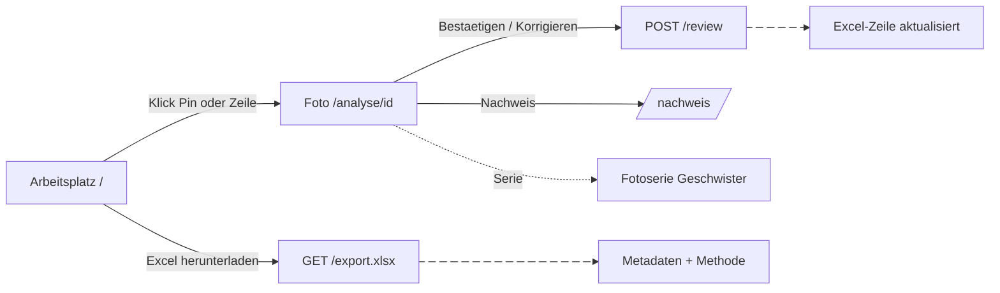
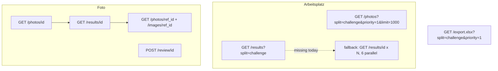

# FRONTPAGE_PLAN: Erschliessungs-Arbeitsplatz SG.CIV.17 (Frontend, v3)

Owner: Timo (`frontend/`). Supersedes the Views, Look and Build order sections of `SCOPE_3_FRONTEND.md`. Where they disagree, this file wins. Contracts: `docs/CONTRACTS.md` v3. Task: `docs/CHALLENGE_BRIEF.md`.

Budget: about 11 hours of AI-assisted build. Fri night and Sat morning, code freeze Sat 14:00, pitch 17:00.

> [!IMPORTANT]
> **For the coding agent:** work through section 10 (Build order) top to bottom on branch `timo/frontend`, inside `frontend/` only. Each item is done when its check passes; commit after each item. Section 2 is the look, section 7 the German copy, section 8 the data. Do not build anything in section 9 (it belongs to Said or Dijar): use the listed fallback and move on. Never use the Kanton Schwyz Wappen or logo. No em dashes, no `rounded-full`.

## 1. What we build, in one picture

The front page is not an upload page. It is a cataloguing desk showing the whole SG.CIV.17 set after the agent processed it. The archivist sees where every photo is, how sure we are, and confirms or corrects in seconds. The Excel is always one click away.



Screens:
1. **Arbeitsplatz** `/`: header counters, map of the canton (left), photo list (right).
2. **Foto** `/analyse/[id]`: photo, fields in the brief's order, review bar, trace replay, "Das Archiv kennt diesen Ort", Excel-Zeile preview.
3. **Nachweis** `/nachweis`: hit rate per confidence bin on the hand-checked sample, plus the postcard eval (exists).
4. **Weiteres Foto prüfen**: a small secondary link. Cut first.

## 2. The look: Kanton Schwyz family, honestly labelled

All values below were read from the live sz.ch CSS (`/public/templates/52/...responsive.css`, GOViS CMS) on 23 Oct 2026. The Staatsarchiv's own catalogue (scopeArchiv Query) uses an unrelated stock theme (Verdana 12px, yellow header). Copy its **vocabulary and record layout**, not its look.

What makes sz.ch recognisable:
1. White page, near-black text, flat surfaces, 4px radius, 1px `#dcdcdc` rules, `#f5f5f5` bands.
2. **One** red, `#e2001a`, used sparingly. The CD manual says "Rot äusserst sparsam verwenden". It appears as the full-width search band under the header, the primary button, red underlined links, and the current breadcrumb segment.
3. Trade Gothic Next: h1 in **Light 300**, large; h2/h3 in Bold 700.
4. Lists are flat (date, bold title, teaser, 1px divider), with no card chrome.

> [!CAUTION]
> **Licensing (verified on sz.ch):** the Kanton Schwyz Wappen and logo "dürfen nur vom Kanton Schwyz oder in dessen Auftrag verwendet werden" (federal Wappenschutzgesetz). Site content needs written consent for reuse. The font is a commercial Monotype licence via the canton's Adobe Fonts kit.
> - **Do not** use the shield, the "kantonschwyz" wordmark or the Typekit kit.
> - **Do** use the colour values, layout patterns, and the free font Barlow.
> - **Do** show "Prototyp" in the header and the footer line "Prototyp für das Staatsarchiv Schwyz, Zentral Hack 2026. Kein offizielles Angebot des Kantons Schwyz."

Owner rules that still apply on top of sz.ch:
1. No `rounded-full` pill badges. Status goes into a muted meta line joined by " · ". Colour a word only when it needs attention.
2. Motion: fades and gentle easing, 300 to 500 ms only.
3. Images and the map carry the colour. Brand red never encodes a data state.
4. No em dashes in UI strings.

### 2.1 Token set (drop-in)

Strategy: **keep Timo's existing token names** (`paper`, `ink`, `accent` and so on, already used by every component), change their values to sz.ch, and add the new ones. The re-skin is then mostly a value swap.

`app/globals.css`, replacing the `:root` block:

```css
:root {
  /* surfaces (sz.ch neutral ramp) */
  --paper:      #ffffff;  /* page background            sz --clr-neutral-100 */
  --paper-2:    #f5f5f5;  /* bands, footer, photo mats  sz --clr-neutral-200 */
  --rule:       #dcdcdc;  /* 1px dividers, borders      sz --clr-neutral-300 */
  --ink:        #191919;  /* body text                  sz --clr-neutral-800 */
  --ink-muted:  #545454;  /* meta lines, labels, input borders  sz --clr-neutral-400 */
  --ink-strong: #000000;  /* link hover                 sz --clr-neutral-900 */

  /* brand (sparingly) */
  --accent:       #e2001a; /* sz --clr-brand: header band, primary button, links, selected pin ring */
  --accent-hover: #c10319; /* sz .btn:hover */
  --accent-dark:  #b50616; /* sz mobile nav panel */
  --accent-light: #f17a7c; /* sz --clr-brand-light: underline of the search field on red */

  /* attention text (not brand red) */
  --warn: #9a4a05;  /* "Prüfung nötig" word, 6.3:1 on white */
  --bad:  #c10319;  /* errors only, 6.4:1 on white */

  /* certainty scale for map + list markers (blue/orange, colour-blind safe, brand red kept out) */
  --cert-confirmed: #0b3c5d;  /* archivist confirmed or corrected (filled + outer ring) */
  --cert-sure:      #1d4e89;  /* overall >= 0.90, 8.4:1 on white */
  --cert-check:     #b35806;  /* 0.50 to 0.89, 4.9:1 on white */
  --cert-open:      #595959;  /* < 0.50: hollow circle, grey stroke */

  /* focus (sz.ch inputs/buttons) */
  --focus-ring: rgba(21, 156, 228, 0.4);

  --radius: 4px;            /* sz --border-radius-400 (0.19em) */
}
```

`tailwind.config.ts` (Tailwind v3, keep the "replace not extend" approach Timo already uses):

```ts
colors: {
  transparent: "transparent", current: "currentColor", white: "#fff",
  paper: "var(--paper)", "paper-2": "var(--paper-2)", rule: "var(--rule)",
  ink: "var(--ink)", "ink-muted": "var(--ink-muted)", "ink-strong": "var(--ink-strong)",
  accent: "var(--accent)", "accent-hover": "var(--accent-hover)",
  "accent-dark": "var(--accent-dark)", "accent-light": "var(--accent-light)",
  warn: "var(--warn)", bad: "var(--bad)",
  cert: { confirmed: "var(--cert-confirmed)", sure: "var(--cert-sure)",
          check: "var(--cert-check)", open: "var(--cert-open)" },
},
borderRadius: { none: "0", DEFAULT: "4px" },       // no "full"
boxShadow: { none: "none", focus: "0 0 0 4px var(--focus-ring)" },
fontFamily: {
  sans: ["var(--font-barlow)", "Helvetica", "Arial", "sans-serif"],
  mono: ["var(--font-plex-mono)", "ui-monospace", "monospace"],
},
fontWeight: { light: "300", normal: "400", medium: "500", bold: "700" },
fontSize: {
  meta:    ["13px", { lineHeight: "18px" }],
  small:   ["14px", { lineHeight: "20px" }],
  body:    ["16px", { lineHeight: "24px" }],
  h3:      ["18px", { lineHeight: "24px", fontWeight: "700" }],
  h2:      ["24px", { lineHeight: "30px", fontWeight: "700" }],
  page:    ["40px", { lineHeight: "48px", fontWeight: "300" }],  // phone: text-[30px]
  counter: ["32px", { lineHeight: "36px", fontWeight: "300" }],
},
maxWidth: { wrapper: "1520px" },                   // sz .wrapper: 92% wide, max 1520
transitionDuration: { fade: "400ms" },
```

Fonts (`app/layout.tsx`, `next/font/google`): **Barlow** 300/400/500/700 as `--font-barlow` (closest free relative of Trade Gothic Next: straight-sided grotesque with a real Light weight), and **IBM Plex Mono** 400/500 as `--font-plex-mono` (keep it for signatures, coordinates and percentages). Drop Source Serif 4 and IBM Plex Sans.

Type rules:
1. The page title (`text-page`) is Light 300, like sz.ch h1. Section titles are Bold 700.
2. Signatures (`SG.CIV.17.3`) are always mono, in the exact dotted form.
3. Percentages are mono with a thin space: `86 %`. Never a progress bar on its own.
4. Body is 16px, not sz.ch's 21px: this is a work tool, not a reading page.

### 2.2 Component look (sz.ch patterns)

| Element | Spec |
|---|---|
| Header row | White, 72px desktop / 56px phone. Left: "Staatsarchiv Schwyz" (400) + " · Erschliessungs-Assistent" (300, ink-muted). Right: muted links "Nachweis", "Methode", and a `bg-paper-2` tag `Prototyp` (`rounded px-1.5 h-5 text-[11px]`). **No shield, no wordmark.** |
| Red band | Full width `bg-accent`, 64px desktop / 52px phone. Search input, white 22px Light text, placeholder "Signatur, Ort oder Gebäude suchen", 1px `accent-light` underline, white lucide search icon. This is the one big red surface. |
| Context band | `bg-paper-2`: the counters row on the Arbeitsplatz, the "Mehr zum Foto" links on the detail page. Like sz.ch's "Mehr zum Thema". |
| Breadcrumb | sz.ch chevron segments on `paper-2`, bold 14px; current segment `bg-accent text-white`. Only on the detail page: "Arbeitsplatz › SG.CIV.17 › SG.CIV.17.3". |
| Primary button | `bg-accent text-white font-bold rounded px-4 py-2`, hover `bg-accent-hover`, 400 ms colour fade. Only for **Bestätigen** and **Excel herunterladen**. |
| Secondary button | `bg-white text-ink-muted border border-rule font-bold rounded`, hover text black. Korrigieren, Überspringen, Weiteres Foto prüfen. |
| Input | 1px `ink-muted` border, radius 4px, focus `border-ink-strong shadow-focus`. |
| Links | Red and underlined in body text, black on hover (sz.ch). In meta lines, ink-muted and underlined. |
| List row | Flat: thumbnail, bold signature line, one meta line, 1px `rule` divider. No card chrome or shadow. |
| Alert box | `bg-paper-2` with a 4px left border (sz `.box`): `cert-check` for "Prüfung nötig", `ink-muted` for info. Used for the `confidence_explanation`. |
| Icons | lucide (stand-in for sz.ch's Font Awesome Light), 18px, stroke 1.5. |
| Footer | `bg-paper-2`, 2px `rule` top border, 14px: "Prototyp für das Staatsarchiv Schwyz, Zentral Hack 2026. Kein offizielles Angebot des Kantons Schwyz." · "Karten © swisstopo" · "Fotos © Staatsarchiv Schwyz, nicht zur Weiterverbreitung". |
| Focus | Every interactive element: `shadow-focus` ring (sz.ch blue ring). Never remove outlines. |

## 3. Archive vocabulary and provenance (from the Staatsarchiv's own catalogue)

The Staatsarchiv's SG.CIV.12 records (query.staatsarchiv.sz.ch/detail.aspx?ID=500000) set the conventions:
1. **Titel** pattern "Objekt, Ort: Detail", e.g. "Alterszentrum Acherhof, Schwyz". Build a suggested title from buildings[0] + locality.
2. **Darin** holds the extra detail: street, secondary buildings, mountains in the background. E.g. "Grundstrasse 32; im Hintergrund Mythen".
3. **keine Angabe** for an unknown date. **nicht bestimmbar** for a field the agent could not prove (the brief's term).
4. Signatures always in the dotted form. The default sort inside a priority group is by signature.
5. Swiss spelling: ss, never ß ("Strasse", "Erschliessung").

**AI provenance is the trust feature.** The ETH Bildarchiv's own staff complained that AI keywords were indistinguishable from human ones. We keep them apart:
- Every value carries a provenance meta line: `KI-Vorschlag · ungeprüft`, `geprüft · bestätigt 24.10.2026 14:02`, or `korrigiert · KI: Brunnen`.
- The number is labelled **"Modell-Sicherheit"**, never "Wahrscheinlichkeit". It is a counted-sources score, not a probability.

Glossary for UI copy: Signatur, Titel, Darin, Aufnahmedatum, Ortschaft, Gemeinde, Gebäude, See/Fluss/Berg, Strasse, Ortsbezug, Erschliessung, Erschliessungsstand, KI-Vorschlag, geprüft / ungeprüft, bestätigt, korrigiert, offen, Prüfung nötig, nicht bestimmbar, keine Angabe, Quelle(n), Begründung, Fotoserie, Referenzfoto.

## 4. Screen 1: Arbeitsplatz `/`

### Desktop (1440 x 900, the projector)

```
+--------------------------------------------------------------------------------------------+
| Staatsarchiv Schwyz · Erschliessungs-Assistent                 Nachweis  Methode [Prototyp] |
+--------------------------------------------------------------------------------------------+
|######## (red band)  [Q] Signatur, Ort oder Gebäude suchen ________________________ #########|
+--------------------------------------------------------------------------------------------+
| (paper-2 band)                                                                              |
| Erschliessung SG.CIV.17                                              [ Excel herunterladen ]|
| 603 Fotos · 50 Prio 1 · Aufnahmen 2003 bis 2013                     Weiteres Foto prüfen   |
|                                                                                             |
|   31            14               5                  12 von 50                               |
|   sicher        Prüfung nötig    nicht bestimmbar   Prio 1 geprüft  [=====------] 24 %      |
|   ab 90 %       unter 90 %       Ort offen          9 bestätigt · 3 korrigiert              |
+--------------------------------------------------------------------------------------------+
| KARTE (55%)                                   | FOTOS (45%)                                 |
|                                               | [Prio 1 | Alle 603]   Sortierung: [Unsicher|
|   swisstopo grau, canton outline,             |  zuerst v]   Filter: [Alle v]               |
|   area outside the canton veiled white        |---------------------------------------------|
|                                               | [img] SG.CIV.17.3                            |
|        o  o                                   |       Schwyz · Alterszentrum Acherhof ·      |
|      o  (3) o      .                          |       Grundstrasse 32 · 94 % · bestätigt     |
|         o    @  <- selected (red ring)        |---------------------------------------------|
|    .        o                                 | [img] SG.CIV.17.12                           |
|                                               |       Brunnen · nicht bestimmbar · 72 % ·    |
|  Legende:                                     |       Prüfung nötig                          |
|  ● bestätigt  ● sicher  ● Prüfung nötig       |---------------------------------------------|
|  ○ nicht bestimmbar · 5 Fotos ohne Ort        | [img] SG.CIV.17.40  Serie (4)                |
|                                    © swisstopo|       ...                                    |
+--------------------------------------------------------------------------------------------+
| footer                                                                                      |
+--------------------------------------------------------------------------------------------+
```

### Phone (390 px)

```
+------------------------------+
| Staatsarchiv Schwyz [Prototyp]|
| Erschliessungs-Assistent  [=] |
+------------------------------+
|###[Q] Signatur, Ort ...  #####|
+------------------------------+
| Erschliessung SG.CIV.17       |
| 603 Fotos · 50 Prio 1         |
| 31 sicher · 14 Prüfung nötig  |
| · 5 nicht bestimmbar          |
| 12 von 50 Prio 1 geprüft      |
| [ Excel herunterladen       ] |
+------------------------------+
| [ Liste ] [ Karte ]           |   <- segmented, 4px radius, not pills
+------------------------------+
| [img] SG.CIV.17.3             |
|  Schwyz · Acherhof · 94 %     |
|  bestätigt                    |
| ...                           |
+------------------------------+
```

The counters collapse into one meta line on phone. The map is a tab (list first). The Excel button is full width.

### Behaviour
1. Hovering a list row highlights its pin, and hovering a pin highlights its row (feature-state). Clicking either selects: the map flies to the pin (`jumpTo` under reduced motion) and the row scrolls into view. A second click or Enter opens the detail page.
2. Clicking a pin that holds several photos (same coordinates, e.g. a Fotoserie) opens a small popup list: "3 Fotos an diesem Ort".
3. Counters are clickable filters: "Prüfung nötig" sets the list filter.
4. Sort options: "Unsicherste zuerst" (default for review), "Sicherste zuerst", "Nach Signatur", "Nach Serie".
5. The "Prio 1 | Alle 603" switch is a segmented control. Prio 1 is the default.

### Map spec
- Base: raster `ch.swisstopo.pixelkarte-grau`, `https://wmts.geo.admin.ch/1.0.0/ch.swisstopo.pixelkarte-grau/default/current/3857/{z}/{x}/{y}.jpeg`, tileSize 256. Offline: the same template through `/tiles/...` (needs Data to cache it, see section 9).
- Canton outline: fetch once from `https://api3.geo.admin.ch/rest/services/api/MapServer/ch.swisstopo.swissboundaries3d-kanton-flaeche.fill/5?geometryFormat=geojson&sr=4326`. Unwrap `.feature` and save it as `public/geo/kanton-schwyz.json` (about 108 KB). Draw a 1.5px `ink` line plus a world-minus-canton mask filled white at 0.6 opacity.
- Initial bounds: `[[8.3856, 46.8901], [9.0061, 47.2199]]`, `fitBounds` padding 40, `maxBounds` slightly larger.
- Points: **no clustering**. Pre-aggregate photos by coordinates rounded to 5 decimals into one feature per place, with integer `id`, `count`, `worst_class` and `ids[]`. One GeoJSON circle layer:
  - colour by class (`cert-*`);
  - radius 6 for one photo, up to 11 for ten or more;
  - white 1.5px stroke; `open` is hollow with a grey stroke;
  - confirmed gets an outer 2px ring;
  - hover/selected: radius +3, selected stroke `accent` 3px.
- Count label (symbol layer) only where count > 1.
- Photos without coordinates are not drawn. The legend says "N Fotos ohne Ort", and that phrase is a filter link.
- `role="region" aria-label="Karte der Fotostandorte"`. The list is the accessible alternative.
- Library: keep **raw maplibre-gl 5** as in Timo's `components/map/MapView.tsx` (same SSR pattern via `next/dynamic` with `ssr: false` in `MapPanel.tsx`). Do not add react-map-gl now.

> [!WARNING]
> MapLibre pitfalls:
> 1. Feature-state needs integer feature ids.
> 2. `setData` resets feature-state, so re-apply hover and selection afterwards.
> 3. Stacked points only hit the top one, which is why we pre-aggregate.

## 5. Screen 2: Foto `/analyse/[id]`

### Desktop

```
+--------------------------------------------------------------------------------------------+
| header + red band (same as desk)                                                            |
+--------------------------------------------------------------------------------------------+
| [⌂] › SG.CIV.17 › [SG.CIV.17.3]                       ← Vorheriges   3 von 50   Nächstes →  |
+--------------------------------------------------------------------------------------------+
| FOTO (50%)                                  | ERSCHLIESSUNG                                 |
| +-----------------------------------------+ | Alterszentrum Acherhof, Schwyz       (Titel) |
| |                                         | | KI-Vorschlag · ungeprüft                       |
| |          photo on paper-2 mat           | |                                               |
| |                                         | | Ortschaft      Schwyz                   94 % |
| +-----------------------------------------+ |   Adressverzeichnis · Gebäude 150 m · Serie   |
| SG.CIV.17.3 · Aufnahmedatum 24.02.2005 ·   | | Gemeinde       Schwyz                   94 % |
| NIKON D1X · Staatsarchiv Schwyz            | | Gebäude        Alterszentrum Acherhof  90 % |
|                                             | | See/Fluss/Berg Grosser Mythen           88 % |
| DAS ARCHIV KENNT DIESEN ORT                 | | Strasse        nicht bestimmbar             |
| [2005 photo]   [~1910 Referenzfoto]         | |                                               |
| 2005 · SG.CIV.17.40 | 1910 · SG.CIV.12.4743 | | | Modell-Sicherheit gesamt 94 % · sicher    | |
| Bildabgleich verifiziert (LightGlue, 212   | | | Gemeinde durch 3 unabhängige Quellen ...  | |
| Punkte)                                     | |                                               |
|                                             | | [ Bestätigen ⏎ ] [ Korrigieren K ] [Überspr. N]|
|                                             | | Fotoserie: 4 weitere Fotos dieser Serie (S)   |
+---------------------------------------------+-----------------------------------------------+
| SO ENTSTEHT DAS ERGEBNIS (trace replay, fades in line by line)            [Überspringen]    |
| 1  Betrachte das Bild: Pflegeheim, Mythen im Hintergrund ...                                |
| 2  Suche benannte Gebäude: "Acherhof" · 1 Treffer, Schwyz                                   |
| 3  Adressverzeichnis: Grundstrasse 32, 6430 Schwyz                                          |
+--------------------------------------------------------------------------------------------+
| EXCEL-ZEILE (live)  Dateiname SG.CIV.17.3.jpg · Ortschaft Schwyz · Gemeinde Schwyz ·        |
|                     Gebäude Alterszentrum Acherhof · ... · Review_Status bestätigt          |
| (small map with pin + radius on the right, 240px tall, © swisstopo)                         |
+--------------------------------------------------------------------------------------------+
```

The "nicht bestimmbar" row shows a muted value and no percentage.

### Phone
Stacked in this order: breadcrumb (horizontal scroll, like sz.ch) → photo → field list → review buttons (sticky bottom bar: "Bestätigen" full width, "Korrigieren" next to it) → Begründung box → Archiv kennt diesen Ort (two images stacked) → trace (collapsed `<details>`) → Excel-Zeile → map.

### Field rows (order is fixed by the brief)
| Label | Field | Null text |
|---|---|---|
| Ortschaft | `fields.locality` | nicht bestimmbar |
| Gemeinde | `fields.municipality` | nicht bestimmbar |
| Gebäude | `fields.buildings` (joined "; ") | nicht bestimmbar |
| See/Fluss/Berg | `fields.landscape_features` (joined "; ") | nicht bestimmbar |
| Strasse | `fields.street` | nicht bestimmbar |

Each row:
- label (`text-small text-ink-muted`) | value (`text-body font-medium`) | `86 %` mono, right-aligned;
- one meta line below: the top source kinds joined by " · ", plus provenance;
- expands (400 ms fade) to the evidence list: German `summary`, a link to `url` or to `/analyse/{ref_id}` / the catalogue for `stasz:` ids, and `supports: false` items prefixed "spricht dagegen:".
- Per-field percent turns `warn` below 0.9.
- Under the fields: an alert box with `overall_confidence`, the word "sicher" (>= 0.9) or "Prüfung nötig" (warn), and the `confidence_explanation` sentence.
- "Verworfene Hypothesen" stays a collapsed `<details>` (exists).

### Review (the business-potential feature)
State: `offen` → `bestaetigt` | `korrigiert`. Undo works client-side: the POST is held for 6 s, or until the next decision.

| Key | Action (button label) |
|---|---|
| `Enter` | Bestätigen und weiter |
| `K` | Korrigieren (focus on the weakest field) |
| `1` to `5` | Feld bearbeiten (Ortschaft ... Strasse) |
| `→` / `←` | Nächstes / Vorheriges Foto |
| `N` | Überspringen (no POST, goes to the end of the queue) |
| `Backspace` | Rückgängig |
| `S` | Serie übernehmen (opens the preview) |
| `Esc` | Bearbeiten abbrechen |
| `?` | Tastenkürzel anzeigen (overlay, with a "Tastenkürzel aus" toggle) |

Rules:
1. Listen on the review region, not `window`. Ignore keys while focus is in an input, textarea or open combobox, during IME composition, or with Ctrl/Meta/Alt held. Match on `e.key` (Swiss QWERTZ). Debounce 150 ms per photo. This satisfies WCAG 2.1.4.
2. Show the key next to each button as a muted hint: "Bestätigen ⏎".
3. Korrigieren turns the value into an input in place, prefilled and selected. Ortschaft and Gemeinde get a combobox over the 30 Gemeinden from `contracts/fixtures/gemeinden.json` (copied to `public/fixtures/` by `npm run fixtures`). The combobox is accent-insensitive and has no preselected option. Gebäude and Strasse are free text.
4. Saving with nothing changed sends `bestaetigt`. Any difference sends `korrigiert` with only the changed fields.
5. A corrected field shows the AI value struck through in ink-muted, then "→ new value", with the meta line `korrigiert · KI: Brunnen`.
6. Undo toast: "Bestätigt: SG.CIV.17.3 · Rückgängig (⌫)". It fades after 6 s.
7. On "Prüfung nötig" photos, do **not** preselect Bestätigen. Put focus on the weakest field instead (counters automation bias).
8. After each decision, move focus to the next photo's heading and announce it with `aria-live="polite"`: "Foto 4 von 50".
9. Progress in the header band: "12 von 50 Prio 1 geprüft · 3 korrigiert · ca. 6 Min. übrig". The time estimate is the median seconds per decision over the last 10.
10. End of queue: "Alle 50 Prio-1-Fotos geprüft · 41 bestätigt · 9 korrigiert · 0 übersprungen" + [Excel herunterladen].

### Excel-Zeile (live)
A one-line strip that shows the row exactly as the export will write it (CONTRACTS 6 columns: Dateiname, Ortschaft, Gemeinde, Gebaeude, See_Fluss_Berg, Strasse, Konfidenz_Gesamt, Pruefung_noetig, Review_Status). It is computed client-side from result + review, so it changes the instant the archivist corrects. This is the demo beat "Korrektur → Excel-Zeile ändert sich". The changed cell gets a 400 ms background fade from `paper-2`.

### Das Archiv kennt diesen Ort
- Source: the first `fields.*.evidence[]` item with `kind === "similar_image"`, `ref_id` starting with `stasz:` (or any reference source), and `verified === true` (Said adds this key; until then, the highest `score`).
- Layout: the two images side by side at equal height, captioned in mono "2005 · SG.CIV.17.3" and "1910 · SG.CIV.12.4743 · Staatsarchiv Schwyz". Meta line: "Bildabgleich verifiziert · 212 übereinstimmende Punkte". The archive card links to `record.source_url` (query.staatsarchiv.sz.ch).
- Show it only when a match exists (21 of 50 Prio 1). Otherwise render nothing, not an empty box.
- Staatsarchiv images are local only (never public, never in git). The demo runs on a local backend, so this is fine.

### Fotoserie (light version only)
- `raw.session` gives the sibling ids. Show "Fotoserie: 4 weitere Fotos dieser Serie" with a thumbnail strip (links).
- Full propagation (`S`) opens a preview with a checkbox per sibling, checked by default. Siblings whose own result disagrees are unchecked and get "weicht ab" in warn.
- Only the place fields (Ortschaft, Gemeinde, See/Fluss/Berg) carry over. Each sibling is POSTed with the note "aus Serie übernommen von SG.CIV.17.3". One undo reverts the batch.
- **Build the strip only; the propagation is cut-first.**

### Trace replay
Keep `replayTrace()` (`lib/api.ts`) and `TraceLog.tsx` as they are. Add the v3 tool labels in `lib/labels.ts`: `address_lookup` = "Adressverzeichnis abfragen", `named_buildings` = "Benannte Gebäude suchen"; evidence kinds `address_register` = "Adressverzeichnis", `named_building` = "Benanntes Gebäude", `exif` = "Kameradaten (EXIF)", `session_photo` = "Foto derselben Serie". Heading: "So entsteht das Ergebnis". The result fields fill as the replay ends.

## 6. Screen 3: Nachweis `/nachweis`

1. Big numbers first (sz.ch Light 300, `text-counter`):
   - "Treffer bei Modell-Sicherheit ab 90 %: X von Y";
   - "Gemeinde korrekt (Stichprobe, n = 20)";
   - "Kosten pro Foto ca. 0.05 USD".
2. A table of hit rate per confidence bin (`< 0.5`, `0.5 bis 0.9`, `>= 0.9`) from the hand-checked sample `challenge_qc.jsonl`. Bins are computed client-side when Said exposes the QC compare, or read from a static JSON Dijar provides. Agree the shape on Saturday morning.
3. Below it, the existing postcard eval (keep the current page) as "Zweiter Nachweis: 350 katalogisierte Postkarten".
4. "Methode" anchor: the 5-step confidence method from CHALLENGE_BRIEF section 4 in German. It mirrors the Excel's `Methode` sheet.

If the QC numbers are not ready by 13:00, show only the postcard eval. Never show an empty table.

## 7. German UI copy deck

| Where | String |
|---|---|
| Browser title | Erschliessung SG.CIV.17 · Staatsarchiv Schwyz (Prototyp) |
| Header | Staatsarchiv Schwyz · Erschliessungs-Assistent · Prototyp |
| Search placeholder | Signatur, Ort oder Gebäude suchen |
| Desk title | Erschliessung SG.CIV.17 |
| Desk meta | 603 Fotos · 50 Prio 1 · Aufnahmen 2003 bis 2013 |
| Counters | sicher (ab 90 %) · Prüfung nötig (unter 90 %) · nicht bestimmbar (Ort offen) · {n} von 50 Prio 1 geprüft |
| Buttons | Excel herunterladen · Weiteres Foto prüfen · Bestätigen · Korrigieren · Überspringen · Rückgängig · Speichern · Abbrechen · Serie übernehmen |
| List tabs/sort | Prio 1 · Alle 603 · Unsicherste zuerst · Sicherste zuerst · Nach Signatur · Nach Serie |
| Map | Karte der Fotostandorte · bestätigt · sicher · Prüfung nötig · nicht bestimmbar · {n} Fotos ohne Ort · {n} Fotos an diesem Ort |
| Fields | Titel · Ortschaft · Gemeinde · Gebäude · See/Fluss/Berg · Strasse · Aufnahmedatum · Kamera · Signatur |
| Provenance | KI-Vorschlag · ungeprüft / geprüft · bestätigt {datum} / korrigiert · KI: {alt} / aus Serie übernommen |
| Confidence | Modell-Sicherheit · Modell-Sicherheit gesamt · Begründung · Quellen · spricht dagegen · Verworfene Hypothesen |
| Unknown | nicht bestimmbar (field) · keine Angabe (date) |
| Sections | So entsteht das Ergebnis · Das Archiv kennt diesen Ort · Excel-Zeile · Fotoserie |
| Match meta | Bildabgleich verifiziert · {n} übereinstimmende Punkte |
| Series | Fotoserie: {n} weitere Fotos dieser Serie · Auf {n} weitere Fotos dieser Serie anwenden? · weicht ab · Nicht sicher, einzeln prüfen |
| Toasts | Bestätigt: {sig} · Rückgängig (⌫) / Korrigiert: {sig} · Rückgängig (⌫) / Speichern fehlgeschlagen, bitte erneut versuchen |
| Progress | {n} von 50 Prio 1 geprüft · {k} korrigiert · ca. {m} Min. übrig |
| End | Alle 50 Prio-1-Fotos geprüft · {a} bestätigt · {b} korrigiert · {c} übersprungen |
| Shortcuts overlay | Tastenkürzel · Tastenkürzel aus |
| Empty/error | Noch kein Ergebnis für dieses Foto · Server nicht erreichbar, Demo-Daten werden angezeigt |
| Footer | Prototyp für das Staatsarchiv Schwyz, Zentral Hack 2026. Kein offizielles Angebot des Kantons Schwyz. · Karten © swisstopo · Fotos © Staatsarchiv Schwyz, nicht zur Weiterverbreitung |
| Nachweis | Nachweis · Treffer bei Modell-Sicherheit ab 90 % · Stichprobe von Hand geprüft · Zweiter Nachweis: 350 katalogisierte Postkarten · Methode |

## 8. Data each screen needs



| Screen | Call | Use | Status on Said's server (22 Oct) |
|---|---|---|---|
| Desk | `GET /photos?split=challenge&priority=1&limit=1000` | records: signature, `raw.priority`, `raw.session`, `date.raw` | `priority` filter **missing** |
| Desk | `GET /results?split=challenge` (new, slim: photo_id, fields values + confidences, coordinates, overall, needs_review, review.status) | pins, counters, list meta lines | **missing**; use the fan-out fallback |
| Desk | `GET /export.xlsx?split=challenge&priority=1` | Excel button (plain `<a download>`) | **missing** (on Said's v3 list) |
| Desk | `GET /images/{id}?w=160` | thumbnails | exists |
| Foto | `GET /photos/{id}`, `GET /results/{id}` | everything on the page | exists |
| Foto | `GET /photos/{ref_id}`, `GET /images/{ref_id}?w=800` | Archiv kennt diesen Ort | exists; needs `verified`/`inliers` on evidence (extra keys are allowed by the contract) |
| Foto | `POST /review/{id}` | Bestätigen / Korrigieren | **missing** (on Said's v3 list). Also ask: does a second POST overwrite? |
| Foto | sibling `GET /photos/{id}` + `/images/{id}?w=120` | Fotoserie strip | exists |
| Nachweis | `GET /eval/summary` + QC numbers | proof | eval exists; QC shape to agree Sat |
| All | `GET /health` | mode, `tiles_url` | exists |

`lib/api.ts` additions:
- `listChallenge({priority})`;
- `listResults(ids)`: try the bulk endpoint, on 404 fan out with concurrency 6 and cache in memory;
- `postReview(id, body)`;
- `exportXlsxUrl(query)`;
- `bestReferenceMatch(result)`.

`lib/types.ts`: add `raw` (priority, session, file_name, exif), source/split `challenge`, `locality`, `street`, `confidence_explanation`, `needs_review`, `review`, and the 4 v3 evidence kinds. Make `decade`/`year_range` optional. Mocks: replace `mocks/photos.ts` / `results.ts` with three challenge-shaped items: SG.CIV.17.3 sure with a review, one "Prüfung nötig" with a reference match, one with "nicht bestimmbar" fields.

## 9. Asks for other scopes (pass on via your human, do not build them)

| To | Ask | Why | Without it |
|---|---|---|---|
| Said | Bulk `GET /results?split=&priority=` (slim) | 603 pins and counters in one call | fan-out over `/results/{id}` (fine for 50, slow-ish for 603) |
| Said | `priority` filter on `/photos` | Prio-1 list | filter client-side on `raw.priority` |
| Said | `/review`, `/export.xlsx` | MUST demo beats | buttons disabled with title "Server-Funktion fehlt" |
| Said | `verified`, `inliers` on `similar_image` evidence | honest "verifiziert" label | label "ähnliches Referenzfoto" without "verifiziert" |
| Said | Does a second `POST /review` overwrite? | undo and re-correct | client-side delay queue only |
| Dijar | Offline `pixelkarte-grau` z8 to z12 over the canton bbox (+ z13 to 16 around the demo photos) | desk map with Wi-Fi off | map blank offline, list still works |
| Dijar | QC numbers per confidence bin by Sat 12:00 | Nachweis page | postcard eval only |

## 10. Build order for Timo (each item done when its check passes)

| # | Item | Check | Time |
|---|---|---|---|
| 1 | **Re-skin**: tokens (2.1), Barlow + Plex Mono, header + red band + footer with "Prototyp" | `/` and `/analyse/x` render white/red sz.ch look; no shield anywhere; `grep -r "rounded-full"` empty | 1.0 h |
| 2 | **Types + api v3 + challenge mocks** (section 8) | mock mode shows the 3 challenge mocks with v3 fields; `tsc` clean | 1.0 h |
| 3 | **Detail page v3**: field order, "nicht bestimmbar", per-field % with warn below 0.9, provenance meta line, Begründung box, v3 labels, `REVIEW_THRESHOLD = 0.9` | SG.CIV.17.3 mock shows Schwyz / Schwyz / Alterszentrum Acherhof / Mythen / Grundstrasse 32 in that order | 1.5 h |
| 4 | **Desk list + counters + Excel button** (Prio 1 / Alle, 4 sorts, filter via counters) | 50 rows, counters add up to 50, Excel link has the right URL | 1.5 h |
| 5 | **Review bar + keyboard + undo + Excel-Zeile** | Enter confirms and advances; K + edit + Enter shows strike-through and the Excel-Zeile changes; Backspace undoes; typing "K" in an input does not trigger | 2.0 h |
| 6 | **Desk map**: grey tiles, canton outline + mask, aggregated circles, legend, hover sync both ways, fly to selection | hover a row = pin grows; click pin = row selected; "N Fotos ohne Ort" shown | 1.5 h |
| 7 | **Das Archiv kennt diesen Ort** | a Prio-1 photo with a match shows both images + meta line; one without shows nothing | 1.0 h |
| 8 | **Demo mode run-through** with Said's backend, cached results, Wi-Fi off | full demo script (section 11) runs offline on the M4 Air | 0.5 h |
| 9 | **Nachweis**: QC bins on top of the existing page | numbers match the QC file | 0.5 h |
| 10 | **Phone pass** at 390 px | no horizontal scroll; list/map tabs; sticky review bar | 0.5 h |
| 11 | Fotoserie strip (no propagation) | SG.CIV.17 photo with `raw.session` shows sibling thumbnails | 0.5 h |

Total about 11.5 h. Items 1 to 8 (9.5 h) are the demo. Merge to `main` after item 3 (Fri 23:00 checkpoint) and after item 8 (Sat 10:00).

## 11. Demo script (3:00, demo mode, local backend, pre-checked cards only)

| Time | Screen / click | Line |
|---|---|---|
| 0:00 | Arbeitsplatz: map + counters | "603 unerschlossene Fotos. Von Hand 5 bis 30 Minuten pro Bild. Hier: alle verortet, nach Sicherheit eingefärbt." |
| 0:20 | Click SG.CIV.17.3; trace replays | "Pflegeheim, Mythen im Hintergrund. Es sucht benannte Gebäude, findet den Acherhof, fragt das Adressverzeichnis: Grundstrasse 32. Ralphs Beispiel." |
| 1:00 | Fields + Begründung | "Jeder Wert nennt seine Quellen. Die Sicherheit ist gezählt, nicht geraten." |
| 1:15 | → to a photo with a match: Das Archiv kennt diesen Ort | "Das Archiv kennt diesen Ort schon: verifiziert gegen die eigene Postkarte von 1910. 21 von 50." |
| 1:40 | Low-confidence photo: K, fix the Gemeinde, Enter; Excel-Zeile updates | "Die Archivarin korrigiert in Sekunden. Was wir nicht beweisen können, bleibt leer." |
| 2:05 | Enter, Enter (two confirms), the counter ticks | "50 Prio-1-Fotos in 10 Minuten statt Tagen." |
| 2:20 | Excel herunterladen; the pre-opened file shows `Konfidenz_Begruendung` + sheet `Methode` | "Eine Zeile pro Foto, importbereit." |
| 2:40 | Nachweis | "Von Hand geprüft: X von Y richtig ab 90 %. Rund 5 Rappen pro Foto." |
| 2:55 | Back to the desk | Close. |

Drop the Nachweis beat first if over time. Backup video at 14:00. Never run `/analyze` live.

## 12. Cut first (in this order)

1. "Weiteres Foto prüfen" upload (live risk, 1 h).
2. Fotoserie propagation (`S`, batch POST). Keep the strip or just the line.
3. Phone polish beyond "no horizontal scroll".
4. `?` shortcuts overlay (keep the inline key hints).
5. Map hover sync list → map (keep pin → detail).

Never cut: the Excel button, the brief's field order with "nicht bestimmbar", Bestätigen/Korrigieren, the trace replay, the "Prototyp" label.

## 13. Keep / change / delete in the current code (`origin/timo/frontend`)

| Keep | Change | Delete or replace |
|---|---|---|
| `TraceLog.tsx`, `replayTrace()`, `MapPanel.tsx`, `MapView.tsx` (detail map), `nachweis/*`, `copy-fixtures.mjs`, `next.config.ts`, mode switch in `lib/api.ts` | `globals.css` + `tailwind.config.ts` (tokens), `layout.tsx` (fonts, title), `SiteHeader.tsx` (sz header + band), `FieldRow.tsx` (inline edit, null text, ref links), `Confidence.tsx` (0.9), `ResultPanel.tsx` (Begründung, review), `PhotoPanel.tsx` (EXIF), `ExportButtons.tsx` (xlsx, drop JSON), `lib/format.ts` ("nicht bestimmbar", "Aufnahmedatum", replace the en-dash empty placeholder with "nicht bestimmbar"), `lib/labels.ts` (v3 order + labels), `analyse/[id]/page.tsx` (prev/next over the list, review bar) | `app/page.tsx` (becomes the desk), `PhotoCard.tsx` (becomes a list row), `mocks/photos.ts` + `results.ts` (challenge-shaped) |

## 14. Sources
- sz.ch CSS: `https://www.sz.ch/public/templates/52/63381-normalize_94918-basics_94917-application_94882-layout_90125-responsive.css`; CD manual 2013: `https://www.sz.ch/public/upload/assets/66823/Manual_Kanton_Schwyz_2013.pdf`
- Wappen/logo rule: `https://www.sz.ch/kanton/medien-und-datenschutz/kantonswappen-und-logo.html/8756-8757-8803-10030`; Nutzungshinweise: `https://www.sz.ch/services/rechtliches/nutzungshinweise.html/8756-8761-10330-10329`
- Staatsarchiv record pattern: `https://query.staatsarchiv.sz.ch/detail.aspx?ID=500000`
- swisstopo terms: `https://www.geo.admin.ch/en/general-terms-of-use-fsdi`; WMTS: `https://docs.geo.admin.ch/visualize-data/wmts.html`
- Uncertainty encoding: MacEachren et al. 2012, IEEE TVCG 18(12)
- Review UX: Prodigy docs, Linear triage, WAI-ARIA APG combobox, WCAG 2.1.4; automation bias: Kern et al., HDSR 2026
- AI labelling precedent: ETH Bildarchiv Clarifai slides (BiblioCon 2024)
