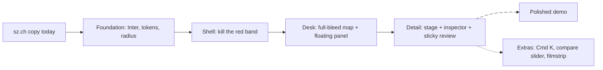

# FRONTPAGE_POLISH: "Swiss modern" re-skin (Frontend, v3.1)

Owner: Timo (`frontend/`). This file **replaces section 2 (Look) and the layout sketches in sections 4 and 5 of `docs/FRONTPAGE_PLAN.md`**. Behaviour, data, German copy, review keys and the demo script in FRONTPAGE_PLAN stay as they are.

> [!IMPORTANT]
> **For the coding agent:** this is a re-skin of a working app on branch `timo/frontend`, inside `frontend/` only.
> - Work through section 9 top to bottom. Commit and push after each item, once its check passes and the app still runs in mock mode.
> - Do not change behaviour, API calls, review logic or German strings unless an item says so.
> - Hard rules: no Kanton Schwyz Wappen or logo; keep "Prototyp" visible; no `rounded-full` pill badges (small status dots are fine); motion only fades and gentle easing (hover colour 200 ms, everything else 300 to 400 ms, never spring or bounce); no em dashes; light theme only.

## 1. Direction in one paragraph

Think "admin.ch 2024 meets Linear". The page is a quiet white work surface with hairline borders. Inter sets the type, with near-black text and tabular numbers. The photos and the map dots carry the colour. Kanton Schwyz red appears in only five places:
1. a 2px strip at the very top;
2. the two commit actions (Bestätigen, Excel herunterladen);
3. the selected row marker;
4. the selected map pin;
5. the active filmstrip frame.

Everything fits one 1440x900 viewport with no page scroll on the desk, and the review action is always visible.



## 2. What changes vs. today (from the screenshot audit)

| Today | New |
|---|---|
| 72px header + 64px red search band = 136px chrome | 52px white header with a 2px red top strip; search becomes a "Suchen ⌘K" field in the header |
| Barlow 300/700, IBM Plex Mono everywhere | Inter (UI) with tabular numbers; Geist Mono only for signatures and the Excel row |
| Grey hero band with floating Light 32px counters, half empty | Compact KPI strip inside the list panel, numbers 20px semibold tabular |
| Map 55% / list 45% under the hero, page scrolls | Full-bleed map fills the viewport, list floats on the left as a 400px panel |
| Blurry oversized raster labels, heavy black outline | Softened raster (paint values), thinner outline, white mask 0.75, two-layer dots with a soft shadow |
| Black segmented control, native selects | Soft segmented control and a Radix Select/Popover styled like the owner's apps |
| Red filled breadcrumb segment | Plain breadcrumb, current item in ink, no fill |
| Review bar below the fold, 44px bold outlined buttons | Sticky review footer in the inspector, 32px soft buttons with kbd hints |
| Focus box and blue glow on page load | `:focus-visible` only; programmatic focus shows no ring until the keyboard is used |
| Black undo toast mid-screen | sonner toast bottom-centre, white, hairline border |

Keep: tokens discipline, certainty colours (blue/orange/hollow, red never for data), the " · " meta lines, field rows with strike-through corrections and provenance, the Begründung box, Archiv-Match, keyboard flow, Excel-Zeile flash, the phone list/map tabs.

## 3. Tokens (drop-in)

Change the variables to **RGB channels**, so Tailwind opacity modifiers work (`border-ink/10` currently does nothing because colours are `var(--x)` hex). Keep the existing token names, so components keep compiling.

`app/globals.css`:

```css
:root {
  /* surfaces */
  --canvas:    250 250 250;  /* #fafafa app background behind panels and the photo stage */
  --paper:     255 255 255;  /* #ffffff panels, header, rows */
  --paper-2:   244 244 245;  /* #f4f4f5 hover, segmented track, kbd, mats */
  --rule:      0 0 0;        /* use as rule/8 (hairline) and rule/12 (default border) */

  /* text */
  --ink:        23 23 23;    /* #171717 primary text, 17.9:1 */
  --ink-muted:  107 107 107; /* #6b6b6b meta lines, labels, 5.3:1 */
  --ink-strong: 0 0 0;

  /* brand: Kanton Schwyz red, sparingly */
  --accent:       226 0 26;  /* #e2001a */
  --accent-hover: 193 3 25;  /* #c10319 */
  --accent-soft:  226 0 26;  /* use as accent-soft/[0.06] for the selected row and changed Excel cell */

  /* attention and data (unchanged values) */
  --warn: 154 74 5;          /* #9a4a05 "Prüfung nötig" word */
  --bad:  153 25 30;         /* #99191e errors (darker than brand red, Bund pattern) */
  --cert-confirmed: 11 60 93;   /* #0b3c5d */
  --cert-sure:      29 78 137;  /* #1d4e89 */
  --cert-check:     179 88 6;   /* #b35806 */
  --cert-open:      89 89 89;   /* #595959 hollow */

  /* focus: sz.ch blue, never red (Bund/zh.ch pattern) */
  --focus: 21 156 228;       /* #159ce4 */
}
html { font-feature-settings: "cv11", "ss01"; scrollbar-gutter: stable; }
.tnum { font-variant-numeric: tabular-nums; }
::selection { background: rgb(226 0 26 / 0.15); }
@media (prefers-reduced-motion: reduce) {
  *, *::before, *::after { animation-duration: .01ms !important; transition-duration: .01ms !important; }
}
```

`tailwind.config.ts` (stay on Tailwind 3.4, keep "replace not extend"):

```ts
const c = (v: string) => `rgb(var(--${v}) / <alpha-value>)`;
colors: {
  transparent: "transparent", current: "currentColor", white: "#fff", black: "#000",
  canvas: c("canvas"), paper: c("paper"), "paper-2": c("paper-2"), rule: c("rule"),
  ink: c("ink"), "ink-muted": c("ink-muted"), "ink-strong": c("ink-strong"),
  accent: c("accent"), "accent-hover": c("accent-hover"), "accent-soft": c("accent-soft"),
  warn: c("warn"), bad: c("bad"), focus: c("focus"),
  cert: { confirmed: c("cert-confirmed"), sure: c("cert-sure"), check: c("cert-check"), open: c("cert-open") },
},
borderRadius: { none: "0", sm: "4px", DEFAULT: "6px", lg: "10px", dot: "9999px" },  // "dot" only for 6px status dots
boxShadow: {
  none: "none",
  panel: "0 1px 2px rgb(0 0 0 / 0.04), 0 8px 24px rgb(0 0 0 / 0.08)",   // floating list panel, popovers
  pop:   "0 12px 32px rgb(0 0 0 / 0.12)",                                 // dialogs, Cmd K
  kbd:   "inset 0 -1px 0 rgb(0 0 0 / 0.08)",
},
fontFamily: {
  sans: ["var(--font-inter)", "system-ui", "sans-serif"],
  mono: ["var(--font-geist-mono)", "ui-monospace", "monospace"],
},
fontWeight: { normal: "400", medium: "500", semibold: "600" },   // no 300, no 700
fontSize: {
  micro: ["11px", { lineHeight: "14px" }],   // kbd, map labels
  meta:  ["12px", { lineHeight: "16px" }],   // meta lines, labels
  ui:    ["13px", { lineHeight: "18px" }],   // list rows, buttons, inputs, body of the tool
  base:  ["14px", { lineHeight: "20px" }],   // field values, Begründung
  h3:    ["15px", { lineHeight: "20px", fontWeight: "600" }],
  h2:    ["18px", { lineHeight: "24px", fontWeight: "600", letterSpacing: "-0.01em" }],
  h1:    ["24px", { lineHeight: "30px", fontWeight: "600", letterSpacing: "-0.02em" }],
  kpi:   ["20px", { lineHeight: "24px", fontWeight: "600", letterSpacing: "-0.01em" }],
  hero:  ["40px", { lineHeight: "44px", fontWeight: "600", letterSpacing: "-0.025em" }],  // Nachweis numbers, compare years
},
transitionDuration: { hover: "200ms", fade: "350ms" },
transitionTimingFunction: { calm: "cubic-bezier(0.2, 0.7, 0.3, 1)" },   // the owner's apps use this easing
```

Fonts (`app/layout.tsx`, `next/font/google`): **Inter** (variable, `--font-inter`) and **Geist Mono** (`--font-geist-mono`). Remove Barlow and IBM Plex Mono in the same commit.
- Why Inter: it is the typeface of zh.ch and bs.ch (the modern Swiss cantonal look), the crispest free grotesque at 13px, and has real tabular numbers.

Type rules:
1. The tool's body is 13px; field values are 14px.
2. Headings are semibold 600 with negative tracking. Never Light, never Bold 700.
3. Mono only for signatures (`SG.CIV.17.3`) and the Excel-Zeile. Percentages, counters, dates and camera info use Inter `.tnum`.
4. Uppercase only for tiny section labels: `text-meta font-medium uppercase tracking-[0.06em] text-ink-muted`.

## 4. Component recipes (class strings)

| Component | Classes |
|---|---|
| Top strip | `h-[2px] bg-accent` (fixed above the header) |
| Header | `sticky top-0 z-30 h-[52px] bg-paper/85 backdrop-blur-md border-b border-rule/[0.08] flex items-center gap-4 px-4` |
| Wordmark | `text-ui font-semibold text-ink` "Staatsarchiv Schwyz" + `text-ui text-ink-muted` " · Erschliessung". No icon, no shield. |
| Prototyp tag | `rounded-sm px-1.5 h-5 inline-flex items-center text-micro font-medium bg-paper-2 text-ink-muted` (12px readable, no border) |
| Search trigger | `h-8 w-[320px] rounded border border-rule/[0.12] bg-paper px-2.5 text-ui text-ink-muted flex items-center gap-2 hover:border-rule/20` + lucide Search 14px + Kbd "⌘K" at the right |
| Primary button | `h-8 px-3 rounded bg-accent text-white text-ui font-medium inline-flex items-center gap-1.5 hover:bg-accent-hover transition-colors duration-hover active:translate-y-px` |
| Secondary button | `h-8 px-3 rounded bg-paper-2 text-ink text-ui font-medium hover:bg-rule/[0.08] transition-colors duration-hover` (soft fill, no outline, owner apps) |
| Ghost button | `h-8 px-2 rounded text-ink-muted hover:bg-paper-2 hover:text-ink` |
| Kbd | `inline-flex h-5 min-w-5 items-center justify-center rounded-sm px-1 font-mono text-micro text-ink-muted bg-paper-2 border border-rule/[0.10] shadow-kbd` (on red buttons: `bg-white/20 text-white border-white/20`); hidden on touch: `[@media(pointer:coarse)]:hidden` |
| Focus | `outline-none focus-visible:ring-2 focus-visible:ring-focus/50 focus-visible:ring-offset-1 focus-visible:ring-offset-paper` on every interactive element. Never style `:focus` without `-visible`. |
| Segmented control | track `inline-grid grid-flow-col gap-0.5 rounded bg-paper-2 p-0.5`; item `h-7 px-2.5 rounded-sm text-ui text-ink-muted`; active `bg-paper text-ink shadow-[0_1px_2px_rgb(0_0_0/0.06)]` |
| Select | Radix `Select` or `Popover` with trigger styled as the search trigger (h-8), content `rounded-lg bg-paper border border-rule/[0.08] shadow-panel p-1`, item `h-8 px-2 rounded-sm text-ui data-[highlighted]:bg-paper-2` |
| List row | `group relative grid grid-cols-[64px_minmax(0,1fr)] gap-3 px-3 py-2.5 border-b border-rule/[0.06] hover:bg-paper-2/70 transition-colors duration-hover cursor-pointer`; selected: `bg-accent-soft/[0.06]` + `before:absolute before:left-0 before:inset-y-2 before:w-[2px] before:bg-accent` |
| Row thumbnail | `h-11 w-16 rounded-sm object-cover bg-paper-2` |
| Row title line | status dot `size-1.5 rounded-dot bg-cert-*` + `font-mono text-ui text-ink` signature + `text-meta text-ink-muted` "Serie (5)" |
| Meta line | `text-meta text-ink-muted truncate tnum`, facts joined " · ", only the attention word coloured (`text-warn`) |
| Floating panel | `absolute left-3 top-3 bottom-3 w-[400px] rounded-lg bg-paper border border-rule/[0.08] shadow-panel flex flex-col overflow-hidden` |
| Section label | `text-meta font-medium uppercase tracking-[0.06em] text-ink-muted` |
| Field row | `grid grid-cols-[112px_minmax(0,1fr)_56px] items-baseline gap-3 py-3 border-b border-rule/[0.06]`; label `text-meta text-ink-muted`; value `text-base font-medium text-ink`; percent `text-ui tnum text-right` (`text-warn` below 0.9); meta below the value `text-meta text-ink-muted` |
| Field input (Korrigieren) | sits in the value column at the same width for every row: `h-8 w-full rounded border border-rule/[0.12] bg-paper px-2 text-base focus-visible:ring-2 ring-focus/50` |
| Begründung box | `rounded bg-paper-2/70 px-3 py-2.5 text-base` + left `border-l-2 border-cert-check` (or `border-cert-sure` when sicher) |
| Toast (sonner) | `<Toaster position="bottom-center" toastOptions={{ classNames: { toast: "bg-paper border border-rule/[0.08] shadow-pop text-ui rounded-lg" } }} />`, undo toasts `duration: 6000` |
| Empty state | one muted sentence: `py-10 text-center text-ui text-ink-muted` |
| Skeleton | `bg-rule/[0.05] rounded-sm animate-in fade-in duration-300` (static, no shimmer) |
| Footer | removed from the desk (one viewport). On detail and Nachweis: one `text-meta text-ink-muted` line, the three facts joined " · " |

## 5. Desk `/`: one viewport, map first

### Desktop (1440 x 900)

```
+==============================================================================================+  <- 2px red strip
| Staatsarchiv Schwyz · Erschliessung  [Prototyp]   [Q Suchen oder springen      ⌘K]   Nachweis  [Excel herunterladen] |  52px
+----------------------------------------------------------------------------------------------+
| +----------------------------------+                                                         |
| | SG.CIV.17 · 603 Fotos · 2003-2013|                                                         |
| |                                  |              FULL-BLEED MAP (canvas to edges)            |
| | 31        14          5          |                                                         |
| | sicher    Prüfung     nicht      |          canton outline 1.25px, outside veiled white      |
| |           nötig       bestimmbar |                                                         |
| | ▬▬▬▬▬▬▬▬▬▬▬▬▬▬▬▬▬------  12 / 50 |                  •   •                                  |
| | Prio 1 geprüft · 3 korrigiert    |               •   (3)   •                               |
| |----------------------------------|                     ◉  <- selected, red ring             |
| | [Prio 1|Alle 603]  [Unsicherste v]|                 •        •                              |
| |----------------------------------|                                                         |
| |▌[img] SG.CIV.17.12  ●            |                                                         |
| |       Brunnen · 72 % · Prüfung nötig                                         [+][-]         |
| | [img] SG.CIV.17.40  ○  Serie (5) |   [● bestätigt ● sicher ● Prüfung nötig ○ nicht bestimmbar · 5 ohne Ort] |
| |       nicht bestimmbar · 20 %    |                                                © swisstopo |
| | ...  (scrolls inside the panel)  |                                                         |
| +----------------------------------+                                                         |
+----------------------------------------------------------------------------------------------+
```

- The panel is 400px, inset 12px, `shadow-panel`, `rounded-lg`. The KPI numbers are `text-kpi tnum`, labels `text-meta text-ink-muted`. KPIs stay clickable as filters.
- The progress bar is `h-1 rounded-sm bg-paper-2` with an inner `bg-ink` (not red) and a 500 ms width transition.
- The legend is a small floating card at bottom centre: `rounded bg-paper/90 backdrop-blur border border-rule/[0.08] px-2.5 h-8 text-meta`.
- Map hover popup (optional, item 11): a 160px thumbnail + signature + one meta line, no buttons.

### Phone (390 px)
Keep Timo's current phone desk (it is the best screen). Restyle it only:
- 52px header with the strip;
- KPIs as one meta line;
- the segmented "Liste | Karte" in the new style;
- the full-width primary Excel button;
- the new rows.

No bottom sheet (cut).

### Map polish (keep raw maplibre-gl 5, `components/desk/DeskMap.tsx`)
1. Raster paint on `pixelkarte-grau` (offline-safe): `raster-saturation: -1`, `raster-contrast: -0.15`, `raster-brightness-min: 0.12`, `raster-brightness-max: 0.98`, `raster-opacity: 0.85`, `raster-fade-duration: 300`. Map background colour `#fafafa`.
2. **Online only (optional):** swisstopo vector `https://vectortiles.geo.admin.ch/styles/ch.swisstopo.lightbasemap.vt/style.json` gives crisp labels. Add `customAttribution: "© swisstopo"`. Use it only when `/health` says `offline: false`; otherwise keep the raster. Try it in mock mode and keep whichever looks better on the projector.
3. Labels too big at canton zoom: start at `fitBounds` with `padding: {left: 424, top: 24, right: 24, bottom: 24}` (room for the panel). If the raster labels still look blurry, set `minZoom` so the first view is one integer zoom level (call `map.setZoom(Math.round(map.getZoom()))` after fit).
4. Mask: world-minus-canton fill `#ffffff`, opacity 0.75. Outline `#1a1a1a`, width 1.25, opacity 0.6.
5. Dots as two layers:
   - shadow layer: radius 7, `#000`, opacity 0.18, `circle-blur: 1`, `circle-translate: [0, 1]`;
   - main layer: radius interpolated by zoom (z8: 4, z14: 7), white stroke 1.5;
   - hover: radius +2;
   - selected: separate ring layer, radius +4, stroke 3 `#e2001a`, no fill;
   - confirmed: outer ring `#0b3c5d` 2px;
   - `circle-sort-key` puts selected and sure on top.
6. Re-apply feature-state after every `setData` (it resets).

## 6. Detail `/analyse/[id]`: stage + inspector

### Desktop

```
+==============================================================================================+
| header (52px, same as desk)                                                                  |
+----------------------------------------------------------------------------------------------+
| Arbeitsplatz / SG.CIV.17 / SG.CIV.17.12        [Foto | Vergleich | Karte]     ‹  2 von 50  › |  44px toolbar, white, hairline
+-------------------------------------------------------------+--------------------------------+
| STAGE (canvas #fafafa, photo uncropped, 32px air)           | INSPECTOR 440px (white, scroll)|
|                                                             | ERSCHLIESSUNG        KI-Vorschlag · ungeprüft |
|                                                             | Brunnen                         |  h1 title
|                 +-----------------------------+             |                                 |
|                 |                             |             | Ortschaft   Brunnen        72 % |
|                 |          photo              |             |             Ähnliches Bild · Bildmerkmal |
|                 |                             |             | Gemeinde    Ingenbohl      72 % |
|                 +-----------------------------+             | Gebäude     nicht bestimmbar    |
|                                                             | See/Fluss/  Vierwaldstättersee  |
|  SG.CIV.17.12 · 11.06.2007 · Nikon D1X · Staatsarchiv Schwyz|   Berg      Urirotstock    85 % |
|                                                             | Strasse     nicht bestimmbar    |
| +---------------------------------------------------------+ | ┃ Modell-Sicherheit 72 % · Prüfung nötig |
| | ▢ ▢ ▣ ▢ ▢ ▢ ▢ ▢ ▢ ▢   filmstrip Prio 1, 56px, current red | | ┃ Begründung: Ortschaft durch 2 ... |
| +---------------------------------------------------------+ | SO ENTSTEHT DAS ERGEBNIS  7 Schritte ▸ |
|                                                             | EXCEL-ZEILE                       ▸ |
|                                                             |---------------------------------|
|                                                             | [Bestätigen ⏎] [Korrigieren K] [Überspringen N] |  sticky footer
+-------------------------------------------------------------+--------------------------------+
```

- The stage fills `100vh - 52 - 44`. The photo is `object-contain` on the canvas with no mat, no border and no rounding. Its caption is one `text-meta text-ink-muted tnum` line. The signature is mono, the rest Inter.
- Stage tabs (segmented, top toolbar):
  - **Foto**;
  - **Vergleich**: Archiv-Match; only shown when a match exists;
  - **Karte**: the small detail map, now stage-sized.

  This removes the long scroll and shows the map and match without leaving the review.
- Vergleich: side by side, equal height, years as `text-hero tnum` ("2007", "1910") above each image, source line muted below. Optional `react-compare-slider@4` toggle "Überblenden" (item 10).
- Filmstrip (item 12): the Prio-1 queue as 56px-tall thumbnails, the current one with a `ring-2 ring-accent` and the others at 60% opacity. Click to jump. Arrow keys keep working.
- Inspector: field rows (section 4 recipe) → Begründung box → collapsible "So entsteht das Ergebnis" → collapsible "Excel-Zeile" → Verworfene Hypothesen.
  - During a replay, "So entsteht das Ergebnis" is open at the top and the fields fade in when it ends (existing logic). Afterwards it collapses to one line, "7 Schritte · 4 Quellen".
  - The Excel-Zeile is a two-column key/value list (not a horizontal table that cuts off). The changed cell gets `bg-accent-soft/[0.06]` with a 400 ms fade.
- **Sticky review footer**: `sticky bottom-0 border-t border-rule/[0.08] bg-paper/90 backdrop-blur px-4 py-3 flex gap-2` with Bestätigen (primary, Kbd ⏎), Korrigieren (secondary, Kbd K) and Überspringen (ghost, Kbd N). Always visible at 1440x900.
- Breadcrumb: `text-ui text-ink-muted` with "/" separators. The current item is `text-ink font-medium` with no fill and no mono box.
- Focus: on load, call `.focus({ preventScroll: true })` on the review region. Do not move a visible ring onto a field. The ring appears only via `:focus-visible` after a key press. Keep the `aria-live` announcement.

### Phone
Order: toolbar (‹ 2 von 50 › + stage tabs) → photo → inspector sections → sticky bottom review bar (Bestätigen full width + Korrigieren). Hide the filmstrip on phone.

## 7. Nachweis

- A KPI row of three numbers in `text-hero tnum`, label above in `text-meta text-ink-muted`.
- One table per bin with hairline rows.
- One bar series in `bg-ink`; everything else grey. No red.
- The Methode list as a numbered `text-base` list in a `max-w-[680px]` column.

## 8. Packages (Tailwind 3.4 compatible)

| Package | Version | For | Note |
|---|---|---|---|
| `radix-ui` | 1.8.1 | Select, Popover, Dialog, Tooltip, ToggleGroup | every importing file needs `"use client"` (RSC crash otherwise); wrap in `components/ui/*` |
| `sonner` | 2.0.8 | undo toast | mount `<Toaster>` once in a client `Providers` in `layout.tsx` |
| `cmdk` | 1.1.1 | ⌘K palette (item 9) | pass `keywords={[signature]}` so "SG.CIV.17.3" matches |
| `tailwindcss-animate` | 1.0.7 | `animate-in fade-in duration-300` | v3 plugin; do NOT install `tw-animate-css` (v4) |
| `clsx` + `tailwind-merge` | 2.1.1 / 3.7.0 | `cn()` | |
| `react-compare-slider` | 4.0.0 | Überblenden (item 10) | 3.4 kB, no deps |

> [!WARNING]
> Tailwind v3 traps:
> 1. Do not run the current shadcn CLI (it writes v4 CSS). Paste component code by hand and rewrite the classes to these tokens.
> 2. This config replaces Tailwind's defaults, so `bg-background`, `text-sm`, `shadow-md` and `neutral-*` silently do nothing.
> 3. Opacity modifiers only work after the RGB-channel change in section 3.
> 4. Skip View Transitions and vaul (experimental and unmaintained respectively). Fades only.

## 9. Build order (re-skin, each item leaves a working app)

| # | Item | Check | Time |
|---|---|---|---|
| 1 | **Foundation**: RGB-channel tokens, new tailwind theme, Inter + Geist Mono, `cn()`, Providers + sonner, reduced-motion CSS | app runs in mock mode; `border-ink/10` renders; no Barlow/Plex left (`grep -r "Barlow\|Plex" frontend/app frontend/components` empty) | 45 min |
| 2 | **Shell**: delete `SearchBand.tsx`, new 52px header with 2px red strip, search trigger, readable Prototyp tag, compact footer | desk shows content at y = 54px; red appears only as the strip and the Excel button | 30 min |
| 3 | **Buttons, kbd, focus, toast** everywhere (section 4 recipes) | no 44px outlined buttons left; no focus ring on page load; undo toast bottom-centre | 30 min |
| 4 | **Desk layout**: full-bleed map + floating 400px panel with KPI strip, segmented control, Radix Select, new rows with selected red bar | 1440x900 desk has no page scroll; 50 rows scroll inside the panel; KPI click filters | 1.5 h |
| 5 | **Map polish**: raster paint, mask, thinner outline, two-layer dots, ring layers, fit with panel padding, floating legend | canton fills the free area right of the panel; labels not oversized; selected pin has a red ring | 1 h |
| 6 | **Detail split**: toolbar with breadcrumb + stage tabs + prev/next, stage, 440px inspector, sticky review footer | at 1440x900 Bestätigen is visible without scrolling; Foto/Vergleich/Karte switch with a 300 ms fade | 1.5 h |
| 7 | **Field rows + edit mode**: grid recipe, equal input widths, Inter tnum percents, Begründung box, Excel-Zeile as key/value | K turns all 5 values into equal-width inputs; Excel-Zeile shows all columns without horizontal scroll | 45 min |
| 8 | **Phone pass** at 390 px for desk and detail | no horizontal scroll; sticky review bar; kbd hints hidden on touch | 30 min |
| 9 | ⌘K palette: "Gehe zu SG.CIV.17.…", "Nur Prüfung nötig", "Excel herunterladen" | ⌘K opens, typing "17.3" jumps to the photo | 30 min |
| 10 | Vergleich "Überblenden" slider | toggle swaps side-by-side for a slider | 20 min |
| 11 | Map hover popup with thumbnail | hovering a dot shows its photo | 20 min |
| 12 | Filmstrip under the stage | current frame has a red ring, click jumps | 30 min |
| 13 | Nachweis restyle (section 7) | three hero numbers, no red | 20 min |

Items 1 to 8 total about 7 hours and are the polish that matters for the demo. Items 9 to 13 are extras. Merge to `main` after item 4 and again after item 8.

## 10. Cut first (in this order)
1. Filmstrip (12)
2. Map hover popup (11)
3. Überblenden slider (10)
4. ⌘K palette (9), leaving the header search as a plain input that filters the list
5. Nachweis restyle (13)

Never cut items 1 to 3: they alone remove the dated look.

## 11. Sources
- Bund design system (MIT, tokens reusable, no federal logo): https://github.com/swiss/designsystem
- zh.ch live CSS (Inter, red only as the logo colour, one accent per theme, idea only)
- Linear UI redesign: https://linear.app/now/how-we-redesigned-the-linear-ui ; Vercel Geist type and colour scales: https://vercel.com/geist/typography
- MapLibre raster paint: https://maplibre.org/maplibre-style-spec/layers/ ; swisstopo vector tiles: https://docs.geo.admin.ch/visualize-data/vector-tiles.html
- Owner reference apps: `~/personal/tools/vatra/{vocab,mailsweep,game,plan}` (soft-fill h-8 buttons, hairline lists, Kbd, sonner, calm easing)
